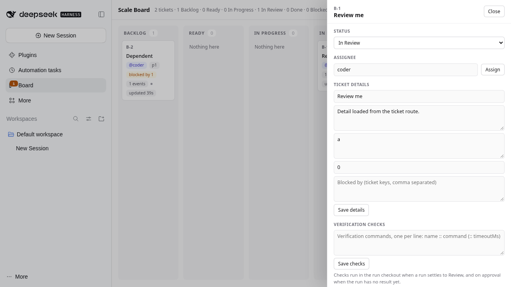
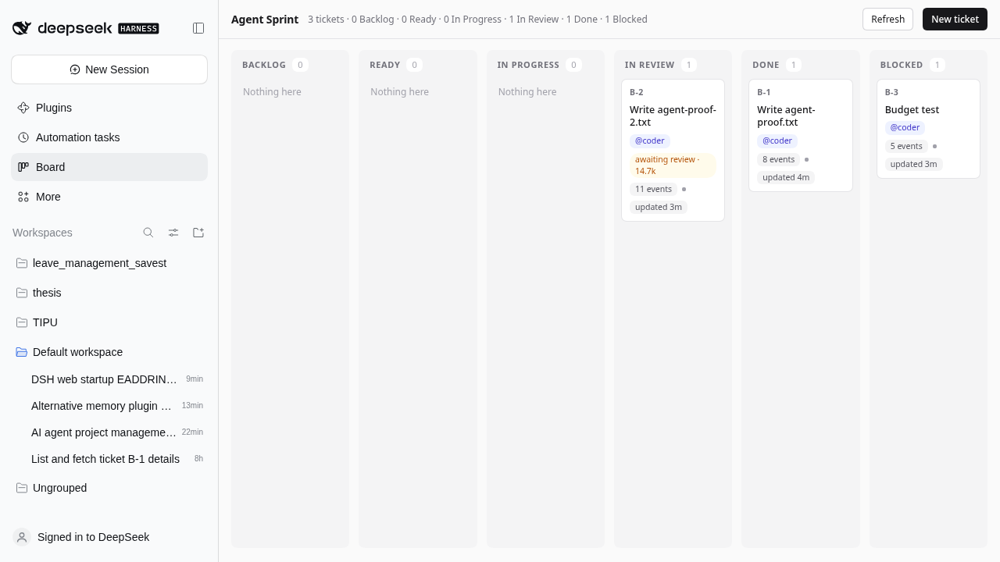
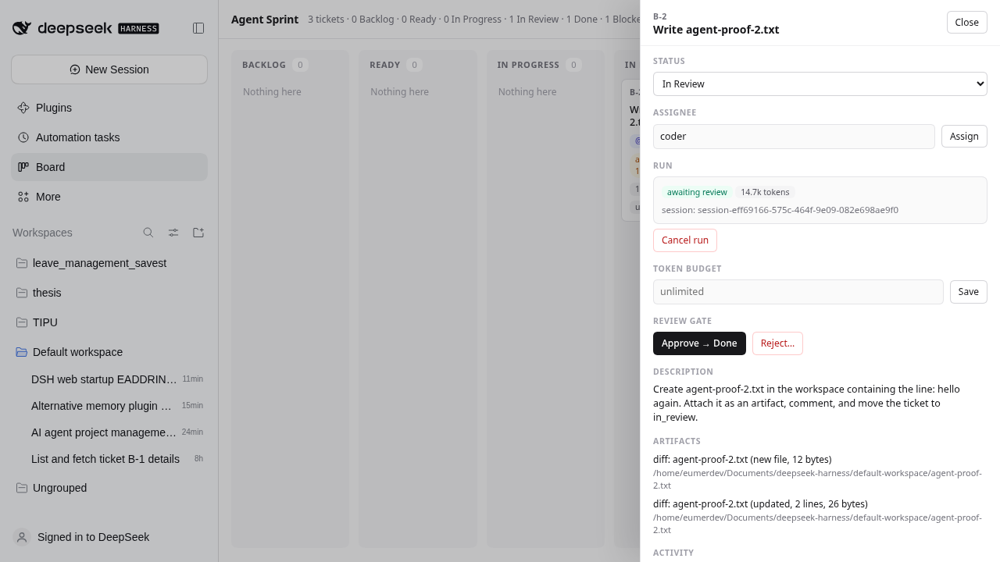
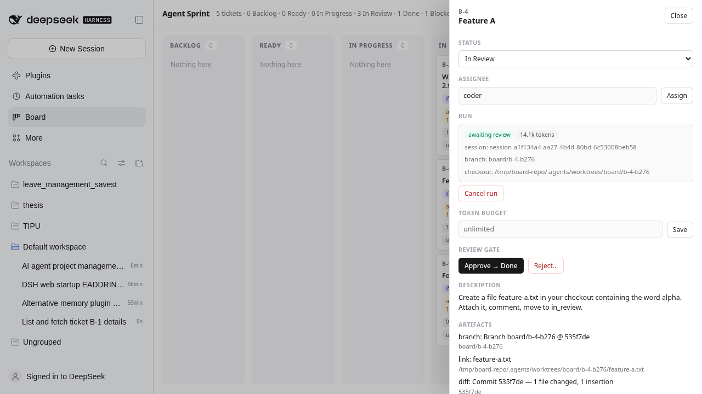
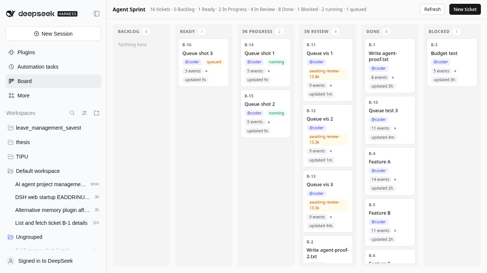
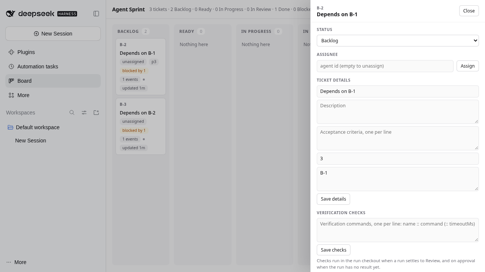
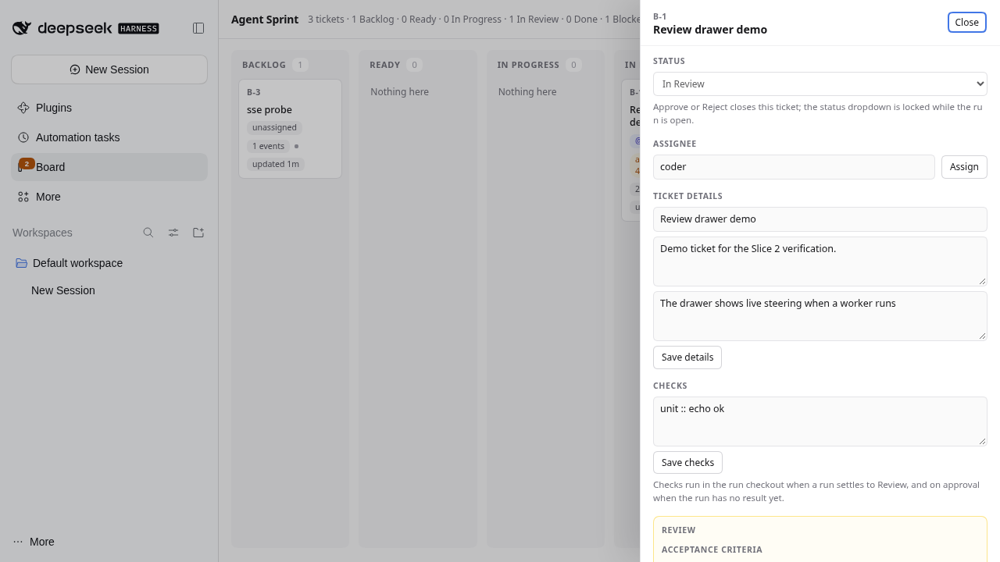
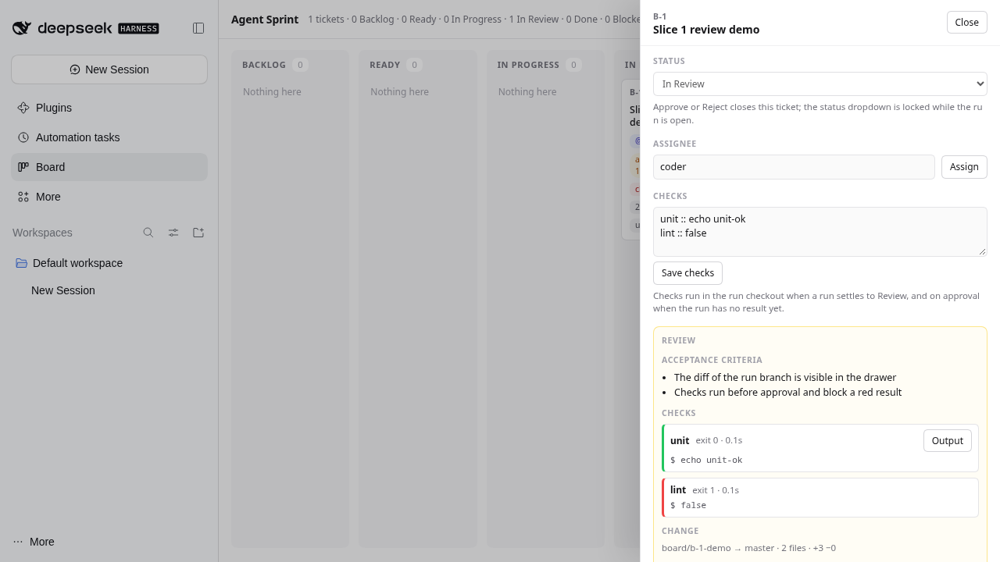
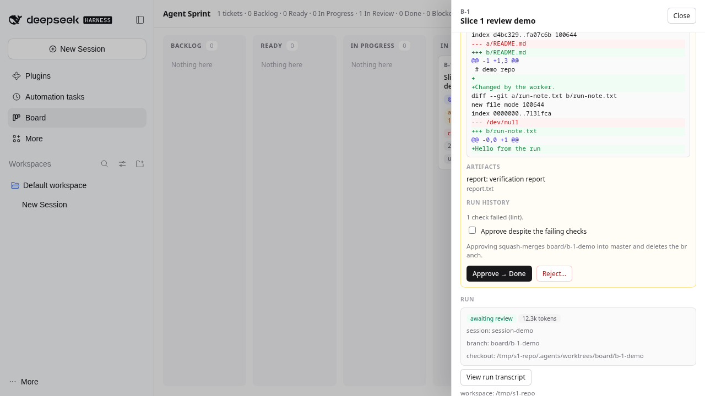

# dsh-board

A DeepSeek Harness profile where the **ticket is the unit of work** and agents are workers.
Linear-shaped board, Jira-shaped gates: create a ticket, hand it to an agent, review the branch it
produced, approve it into the base repository.

Status: **MVP, verified end-to-end** — board, run binding, async review gates, token budgets,
per-ticket Git worktrees, squash-merge approval, transcript access, configurable workflows, visible
queue and retry. Single-user; not yet a team product.



## Install from source (GitHub)

> Not on npm: the plain `dsh-board` name on npm belongs to an unrelated project, so this distribution
> is GitHub-only for now.

Requirements: **DeepSeek Harness** with a web profile, **Node.js >= 20** (24 recommended for the
SQLite backend), **pnpm**, and **Git**.

```sh
git clone https://github.com/HoomerPH/dsh-board.git ~/dsh-board
cd ~/dsh-board
scripts/install-profile.sh          # creates/updates the `board` profile
```

Then launch it from the repository you want agents to work on:

```sh
cd /path/to/your/repo
dsh --profile board
```

Open the printed tokenized URL, click **Board** in the sidebar, and type `/board <work>` in the chat to
create the first ticket. The board writes to `$DSH_HOME/board/board.json` and creates branches as
`board/<ticket>-<run>` inside your repository.

Prefer managing the profile yourself? Set up a profile with `@deepseek-ai/dsh-base`,
`@deepseek-ai/dsh-web-app` and this package, then add a `board` patch row with your workspace path — see
[`scripts/install-profile.sh`](scripts/install-profile.sh) for the exact shape.

## What it does

- **Plan first:** `/board` turns a chat request into a ticket, binds that chat as its planning session,
  and the agent submits a plan; you approve it before any worker runs.
- **Isolated execution:** each run gets its own Git worktree/branch; workers commit, attach artifacts,
  and park at a review gate. Approve = squash-merge; reject = the same session resumes with your notes.
- **Governance that is opt-in:** token/time budgets, WIP limits, trusted checks, independent reviewer
  sessions, webhooks, GitHub/GitLab pull requests, SQLite or append-only journal storage.
- **Auditable:** activity history, run transcripts in the drawer, durable notifications, and a
  single-writer guard for every storage backend.

See [`docs/ROADMAP.md`](docs/ROADMAP.md) for the full slice history and known trade-offs.

**Slice 0 hardening:** the board never starts empty over an unreadable `board.json`, a second instance
cannot clobber tickets, approval refuses the wrong base branch or a rewritten base, concurrent
approvals are serialized per repository, failed merges roll back without `--hard`, the review gate
cannot be bypassed by the status dropdown or by agent tools, and a worker that is still running cannot
be approved/rejected — and a ticket the worker moved to `blocked` can be retried.

**Slice 19A client unit tests (current):** the client bundle now exposes its pure helpers for offline
testing (`__test`), and `test/client.test.mjs` loads the real bundle through a fake module
loader/React to cover CSV quoting, ticket→CSV rows, inline markdown (bold/code/`B-3` links) and the
block renderer (headings/bullets/fenced code). No DOM or browser is needed.

**Slice 20A browser UI suite (current):** `npm run ui` boots a throwaway profile with seeded
tickets and drives a real Chromium (Playwright core, cached browser) through the interactive paths
that have no DOM unit tests: board rendering, search, `/` + `j/k/Enter/Escape` keyboard navigation,
saved views (save/apply/delete), batch select + assign, CSV export contents, the `#B-1` deep link,
the transcript session picker, the GC button removing an orphan branch, and the PR action's presence
on a configured gate ticket. It is separate from `npm test` because it needs a browser.

**Slice 19D card component test:** the hook-free `TicketCard` is exported for tests and rendered
with the fake-React harness: markup covers the key/title, `plan review`, subtask/blocked/dependency
chips, check results, queue position, assignee, focus/selection classes and both click modes
(select-mode toggle vs open). Interactive drawer/board state still relies on live verification because
no DOM harness is available offline.

**Slice 19C journal writer guard:** the journal backend remembers the exact journal size it
last wrote and refuses a save when the file changed underneath it (`board journal changed in another
process; restart this board…`) instead of interleaving/replaying another writer's deltas — the same
"one writer, no silent clobber" contract as the JSON mtime/hash guard and the SQLite revision.

**Slice 19B journal backend:** `backend: 'journal'` keeps `board.json` as the compaction
snapshot and appends per-save deltas (changed tickets, deletions, meta, notifications) to
`board.json.journal` with an fsync — mutations no longer rewrite the whole document. Boot replays the
journal, ignores an unreadable line with a load warning, and compacts (atomic snapshot + truncated
journal + `.bak` rotation) after `journalCompactionLines` (default 200). It is the middle option
between whole-file JSON and SQLite.

**Slice 18C team completion + live transcript:** `board_team_sync` is now bidirectional —
it still mirrors the team owner onto the board assignee, and when the **board ticket is done** it
completes the shared team task through `updateTask(action: "complete", expectedRevision)`; a team
task completed while the board ticket is still open raises a `team_task_done` advisory notification
(the board never auto-merges from a team state). The transcript section also has a **Live: on/off**
toggle that re-fetches the selected session every 3 s while enabled.

**Slice 18B PR auto-sync + transcript fallback:** with `pullRequest.autoSync` the board
polls open pull/merge requests every `pullRequest.pollMs` (default 60 s) using the configured provider
(GitHub `merged`/`merged_at`, GitLab `state: merged`); a merged PR completes the ticket through the
same path as *Mark PR merged*, while a PR closed without merging raises a `pr_closed` notification.
Off by default. The transcript route also falls back to the `zstd` CLI when the runtime has no
`zstdDecompressSync`, so older Node versions can still read compressed session logs.

**Slice 18A remaining integrations:** PR mode now supports **GitLab** (`pullRequest.provider:
'gitlab'`, `PRIVATE-TOKEN`, merge-request payload) alongside GitHub, and completing a PR removes the
worker worktree and branch (`worktree.pruned`) instead of leaving it for GC. Agent Teams gains
**`board_team_sync`**, which refreshes a published ticket from its team task and mirrors the team
owner onto the assignee. The drawer's transcript section has a **session picker** (worker, planning,
reviewer, paused worker) so any board-owned transcript can be embedded, verified live end-to-end.

**Slice 17C reviewer budget + auto-merge proof:** reviewer sessions are now token-budgeted
like runs: with `autonomy.reviewerTokenBudget` set, the board polls the reviewer session
(`reviewerBudgetCheckMs`, default 5 s), cancels it when the budget is exceeded, and records a
`reviewer_budget` notification. The auto-merge **success path** now has an integration test: a real
worktree, a human-sourced check, a reviewer `approved` verdict and `autoMerge: true` merge the ticket
through the normal approval gates.

**Slice 17B safety hardening:** `approvalTtlHours` refuses a merge whose plan approval is
older than the TTL; `checks.allow` / `checks.deny` patterns block matching commands without executing
them (reported as `blocked` check results); failed runs raise a `run_failed` notification; webhooks
retry with exponential backoff (default 2 retries) and record a delivery log exposed as
`board.webhookLog`; and the SQLite backend runs `PRAGMA integrity_check` plus rotates
`board.sqlite.bak*` snapshots on each open, mirroring the JSON backup policy.

**Slice 17A Agent Teams + transcript:** with Agent Teams mounted in the profile, a board
agent can publish a ticket to the shared team board with `board_team_task` (subject defaults to
`B-3: title`, description from the ticket + acceptance criteria; the task id/revision are stored on
the ticket and shown in the drawer). Separately, the drawer can **Show transcript** for the worker's
session: `GET /api/board/transcript?sessionId=` reads the persisted session log (zstd or plain) for a
session the board actually references, filters DSH runtime boilerplate, and returns the last 60
user/assistant/tool messages for inline markdown rendering. Both are read/publish integrations —
board execution stays the source of truth.

**Slice 16A database hardening:** the SQLite backend now guards against a second writer
with a monotonic revision in `meta`: any store instance whose loaded revision is stale refuses the
write with a clear "changed in another process" error instead of clobbering the other writer (the
in-memory mutation rolls back, as with the JSON guard). It also exposes query-friendly ticket columns
(`key, status, assignee, plan_status, archived, priority`, indexed on `status`) alongside the JSON
document, migrates older databases in place, and can write a `board.json`-shaped snapshot on demand —
`/board export` or the `export-json` action — for backup or switching back to the JSON backend.

**Slice 15A SQLite backend:** set `backend: 'sqlite'` (optionally `sqliteFile`) and the
board persists in SQLite (WAL, one row per ticket plus meta/notification rows) instead of rewriting
`board.json` on every mutation. The first boot imports an existing `board.json` (or its `.bak`) so
switching backends is non-destructive; the JSON file is left untouched as a snapshot. Updates are
diffed in memory and only changed rows are written inside a transaction. `board.json` remains the
default; if `node:sqlite` is unavailable the plugin logs and falls back to JSON.

**Slice 14A pull requests:** with `pullRequest: { repository, token, base?, remote?, apiBase? }`
a reviewed ticket can open a real GitHub pull request instead of squash-merging locally: the run
branch is pushed to the configured remote and the PR is created through the API (title `B-3: …`, body
from the plan), recorded on the run and as a `pr` artifact. The drawer shows **Open pull request**
and, once opened, the **PR #n** link plus **Mark PR merged**, which completes the ticket and records the
PR as its merge. Local squash-merge remains the default; nothing changes without the config.

**Slice 13A export:** **Export CSV** and **Export JSON** in the filter bar download exactly
the tickets currently shown (filters and saved views included). CSV columns are `key,title,status,
assignee,plan,priority,blocked_by,updated` with proper quoting; JSON carries `exportedAt`, `count`
and the ticket summaries. Nothing is sent anywhere — the file is built in the browser.

**Slice 12A saved views:** the filter bar can store named views — **Save view** captures the
current search, status, assignee and special filters (prompting for a name), the **Saved views**
dropdown re-applies one in a click, and **Delete view** removes the active one. Views live in local
storage, so they survive reloads without touching the board file.

**Slice 11A insights:** the header **Insights** button opens a compact report computed from
the store: live/archived ticket counts and per-state distribution, 7-day and 30-day throughput,
average and p50 cycle time, tokens per merge, reviews per ticket, and run/check totals with failure
and pass rates. It is available in the state snapshot as `board.insights`.

**Slice 10A links & sessions:** tickets are addressable — opening a drawer writes `#B-3`
to the URL, visiting that hash (or the copied link from the drawer's **Copy link** button) reveals the
Board panel and opens the ticket, closing the drawer clears the hash. The drawer also links straight
to the sessions involved: the worker transcript (existing), the **planning session**, the
**reviewer session**, and the paused worker for a **needs input** ticket.

**Slice 9F worktree GC:** `/board gc` (or the header **GC** button) scans Git for
`board/*` branches and worktrees that no ticket run references — it never touches a referenced
worktree/branch, the workspace checkout itself, or anything outside the `board/` namespace. It is a
**dry run by default**; `/board gc apply` (or confirming the dialog) removes the orphan worktrees,
prunes worktree metadata and deletes their branches, reporting counts and per-target errors.

**Slice 9D webhooks:** configure `webhooks: [{ url, secret?, events? }]` and every new
notification is POSTed as JSON with a Slack-compatible `text` field (`[B-3] plan_review: …`), the
structured fields, and an optional `X-Board-Signature: sha256=…` HMAC. Invalid URLs are ignored at
boot, `events` can filter by notification kind, deliveries are best-effort with a 5 s timeout, and
the pre-existing inbox is never replayed on startup.

**Slice 9B batch actions:** enter **Select** mode in the filter bar, click cards to build a
selection, then **Approve**, **Archive** or **Assign** (agent id) them in one action. The host runs the
`batch` action per ticket (max 50) and returns per-ticket results: successes apply, failures are
reported with their reason (for example a ticket not in review) instead of aborting the batch.

**Slice 9A/9C find & flow:** the board has a filter toolbar — full-text search over key,
title, description and assignee, status and assignee filters, **Plan review** and **Needs input**
toggles, a Clear action, and an "X / Y shown" counter. Filters persist in local storage. Keyboard:
`/` focuses search, `j`/`k` move the focused card (scrolls into view), `Enter` opens it, `Esc` closes
the drawer. `autonomy.defaultAssignee` now assigns an unassigned ticket (and its decomposed
children) when a plan is approved, so the loop is `/board → approve plan → worker runs` without a
second drawer visit.

**Slice 8A reviewer auto-reject:** with `autonomy.autoRejectOnChanges`, a reviewer verdict
of `changes_requested` rejects the ticket automatically with the reviewer's notes — the existing
reject path resumes the same worker session, so the worker immediately sees what must change. When
the policy is off, the verdict is advisory and a human decides. If the reject cannot run (busy
workers, no prior run), the verdict is still recorded and the response says auto-reject was skipped.

**Slice 6D markdown and ticket links:** plan bodies, descriptions and activity/comment text
render as safe inline markdown — headings, bold, inline code, fenced code blocks, bullets — and every
ticket key (`B-3`) in a plan, description or activity line is a clickable link that opens that
ticket's drawer. No HTML is injected: everything is built as React nodes from a small parser.

**Slice 7D inbox UI:** the board header has an **Inbox (N)** button. Opening it fetches the
full state and lists the latest notifications (ticket key, kind, text, age); each row opens its
ticket and marks itself read, and **Mark all read** clears the unread count in one action
(`notifications-read` route action). The panel is verified live in the harness UI.

**Slice 7C reviewer automation and inbox:** with `autonomy.reviewerPreset` set, the board
opens an independent reviewer session as soon as a run parks at the review gate (it gets the ticket,
acceptance criteria, checks and the worker checkout, and is told to call `board_review` without
touching code). Ticket changes raise durable notifications — `needs_input`, `plan_review`,
`review_ready`, `review_verdict` — and `/board notifications` (or `/board inbox`) lists and clears the
inbox; the state snapshot carries the unread count and the last 30 entries. A new run clears the
previous verdict, so a stale approval can never auto-merge fresh work. Client inbox UI is still
deferred.

**Slice 7B reviewer and trusted checks:** a reviewer agent posts an independent verdict
with `board_review` (or `/board review B-3 approved …`): `approved` or `changes_requested`, with
notes recorded on the ticket and shown in the drawer. Checks now carry provenance — `human` edits
and `plan` checks (approved by a human) are trusted; auto-merge is attempted only when
`autonomy.autoMerge` is on **and** the verdict is approved **and** every check is trusted, and it
still goes through the normal approval gates (checks, base branch, drift). Everything else keeps the
human merge gate, and auto-merge is off by default. The notification inbox is still deferred.

**Slice 7A autonomy policy:** a board can opt into agent scheduling without giving up the
merge gate. With `autonomy.agentsCanReady` an agent may move an initial ticket to Ready, and with
`autonomy.agentsCanAssign` it may set the assignee — both are audited on the ticket. `autonomy.wipLimit`
refuses agent triage while that many tickets are already in progress. Auto-merge is pinned off until
trusted checks and an independent reviewer exist (7B). Everything is off by default, so existing
boards behave exactly as before.

**Slice 6C chat control:** a bare `/board` now opens the Board panel (client decoration on
the host command); `/board <work>` still creates the ticket. From the chat: `/board list`,
`/board show B-3`, `/board approve B-3` and `/board answer B-3 <reply>` drive the board without
opening the panel. The sidebar badge's amber attention count now also covers tickets waiting at
**plan review** and **needs input**.

**Slice 6A `/board` intake:** tickets are born from the conversation. Typing `/board <work>`
in a chat creates a Backlog ticket, binds that session as the ticket's planning session, and wakes the
agent to brainstorm it like plan mode; a bare `/board` creates a placeholder ticket and asks for the
work. The agent updates the ticket and submits the plan with `board_submit_plan`; you approve it on
the board, assign an agent, and the worker takes over. The manual New-ticket form (title, description,
acceptance, checks, token budget) is gone.

**Slice 1 review gate:** the reviewer sees the actual change. The drawer opens on a Review
panel with the acceptance criteria, the ticket's **checks** (exit code, duration, output), a read-only
**diff** of the run branch (stat, files, unified patch), artifacts as links, the full run history, and
an approve confirmation that names the branch and base. Failing checks block approval until a human
overrides with a recorded reason. `npm test` covers all of it (146 tests, no model calls), and `npm run e2e` boots a throwaway profile and checks the real routes and panel bundle.

**Slice 5D human handoff:** workers can pause for a decision with `board_ask`. The run stops,
the ticket waits in Blocked with the question shown in the drawer, and **Answer** resumes the *same
session* with your reply (respecting worker capacity; if no slot is free the answer is queued and the
resume happens when one opens). The worker brief now points at `board_ask` instead of a blanket
"never ask".

**Slice 5C subagents:** workers may delegate to subagents, and the board now sees them.
Child sessions are discovered through `session/created` lineage (`parentSession`, including
subagents of subagents), recorded on the run and shown in the drawer/card; their tokens are added to
the run's token budget at every watch tick and at settle; and a per-run fan-out cap
(`maxSubagents`, default 4) cancels the run into Blocked when it is exceeded.

**Slice 5A plan gate:** every ticket can be planned before it is worked. **Start planning**
opens a real harness session bound to the ticket (planner preset configurable, `standard` by default)
where you brainstorm `/plan`-style; the agent submits a plan with `board_submit_plan` (approach,
acceptance criteria, checks and optional subtask decomposition). The ticket then waits at **Plan
Review**; you approve, or request changes and the feedback is sent back into the same session. On
approval the ticket becomes Ready, the decomposition is created as child tickets with
`parentId`/`blockedBy` edges, and when every child merges the parent completes itself. A parent never
dispatches a worker of its own. Merge approval is still human-only.

**Slice 4a scale & operations:** the panel fetches a compact state document (cards only) and loads one ticket's full record on demand, so the push path no longer carries every activity, artifact and run history; `board.json` gained a schema version with a v1→v2 migration, rotating numbered backups, per-completion metrics (7-day throughput) and automatic retention (archive done tickets after N days, prune merged leftovers). An end-to-end smoke script exercises the real routes and the served panel bundle.

**Slice 3 scheduler:** tickets can declare dependencies and a priority; the queue is durable
across restarts and drains by priority; runs can be stopped by a wall-clock budget as well as a token
budget; done tickets can be archived and merged/archived checkouts pruned; worker sessions join the
board's workspace group instead of "Ungrouped"; and the header shows cycle time and tokens per merged
commit.

**Slice 2 live loop (current):** comments on a running ticket are delivered to that worker session
instead of waiting for the next run; the board pushes every change over a server-sent event channel
(`/board/events`, authenticated by the same browser credential) so the panel no longer polls every
3 s; a sidebar badge counts tickets that need a human; and the drawer can edit title, description and
acceptance criteria, pick an agent from the profile's presets, and is keyboard/escape accessible.

| | |
|---|---|
|  |  |
| Run states, budget-blocked and awaiting-review tickets | Ticket drawer: run, branch, token budget, gate |
|  |  |
| A run parked on its own branch with its commit | Queued ticket while two workers run |

## Why

A chat harness makes you the bottleneck: you sit at the prompt, and the work is whatever the last
session said. This board moves the durable unit from the session to the ticket:

- **Ticket is durable, run is disposable.** A run is a lease on a piece of work; the ticket is the record.
- **Agents pick up work, not conversations.** Assigning a Ready ticket creates a real worker session
  with its own checkout, and its output is a branch.
- **Humans hold the gate.** Agents cannot mark work done; approval squash-merges the branch into the
  base repository and deletes it. Rejection resumes the *same* session with your reason.
- **Everything is an event.** Every mutation records actor, kind, text, timestamp.
- **Budgets are stops, not dashboards.** Over-budget runs are cancelled into `blocked`.

## Quickstart

```sh
# 1. install the profile (links this package into ~/.dsh/profiles/board)
scripts/install-profile.sh

# 2. launch from your repository — the board workspace defaults to the launch directory
cd /path/to/your/repo && dsh --profile board

# 3. open the printed tokenized URL, click "Board" in the sidebar
```

Then open **Board** in the sidebar. New work starts in the chat: type **`/board <what you want to do>`**.
The command creates a ticket, binds that chat session as its planning session, and the agent
brainstorms the work with you like plan mode. When the scope is clear the agent submits a plan;
approve it in the Board drawer, assign an agent (e.g. `coder`), and the board dispatches a worker.
The worker commits to its own branch, runs the approved checks, moves the ticket to **In Review**, and
waits for you. Approve → squash-merge; Reject → resumes the same session. There is no New-ticket form —
if the slash command is unavailable (no `commands` service in the profile), use an agent's
`board_create` tool instead.

Overrides:

```sh
DSH_BOARD_WORKSPACE=/path/to/repo dsh --profile board   # explicit workspace
DSH_BOARD_PROFILE=board2 scripts/install-profile.sh    # second profile
```

## The loop

```
human: /board <work> ──▶ ticket created ──▶ agent brainstorms in that chat,
                                             updates the ticket, submits a plan
                                              │  human: approve plan + assign @coder
                                              ▼
                                        ticket Ready ──▶ run controller creates worker session
                                              │  worktree board/<ticket>-<run>, preset "standard"
                                              ▼
                                        worker works, commits, runs checks
                                              │  board_artifact + board_comment
                                              │  board_update → In Review
                                              ▼
                                        ticket In Review ◀── run parked (awaiting review)
                                              │
                  Approve ──▶ squash-merge into base + delete branch + Done
                  Reject  ──▶ same session resumes with the reason, branch kept
```

## Scale and operations


| Piece | Detail |
|---|---|
| Compact state | `GET /api/board/state?summary=1` returns card-sized tickets (run status/tokens/check counts, activity and artifact **counts**, dependencies, budget) without activity, artifacts or run history. The drawer fetches `GET /api/board/ticket?id=` for the full record. Actions still answer with a full snapshot for immediate consistency. |
| Schema | `board.json` carries `version: 2`; a v1 document migrates on load (completion timestamps backfilled from the gate event) and the file is rewritten. |
| Backups | Each save rotates `board.json.bak → .bak.1 → .bak.2 → .bak.3` (configurable), on top of the atomic write. |
| Metrics | Each completion appends `{at, key, cycleHours, reviews, tokens}` (ring of 500). Health exposes 7-day throughput alongside cycle time and tokens per merge. |
| Retention | Hourly (and at boot) done tickets older than `archiveAfterDays` are archived; merged leftovers are pruned. Unmerged branches are never auto-deleted. |
| E2E | `npm run e2e` boots a throwaway profile on a random port, authenticates, and checks summary/detail, create/archive/prune, the SSE handshake and the client bundle reference. |
| UI smoke | `npm run ui` drives a real Chromium over the interactive board paths (search, keyboard, saved views, batch, export, deep link, transcript picker, GC, PR action). Needs a cached Playwright browser or `PLAYWRIGHT_CHROMIUM_EXECUTABLE`. |

## Scheduling and retention



| Piece | Detail |
|---|---|
| Dependencies | `blockedBy` names ticket keys. A dependent in Ready is not dispatched until every dependency is Done (reviewed and merged), and an agent cannot claim it early; cycles, unknown tickets and self-dependencies are refused, and dangling dependencies are dropped on load. When a dependency is approved the pump runs again and the dependent starts as capacity allows. |
| Queue | Waiting tickets are persisted (`queuedAt`) and ordered by priority, then queue time, then key. A restart rebuilds the queue from the board; starting a run — or moving the ticket out of Ready — clears its queue marker, and unarchiving dispatches again. The UI shows `#2 queued` and priority `p5`. Rejecting needs a free worker slot; it refuses rather than over-subscribing the board. |
| Budgets | Tokens and wall-clock minutes are both stops: a run that exceeds either is cancelled into Blocked with a measured reason. The wall-clock deadline starts at dispatch, is re-read from the ticket on every check and at settle, and reports seconds when the budget is short. |
| Archive & prune | Done tickets can be archived (hidden behind a "Show archived" toggle) and restored. Archiving refuses a live run and refuses unmerged work unless forced; restoring dispatches again. `prune` by default removes only checkouts/branches of merged runs on live tickets, keeps live unmerged branches, skips anything with an active run, and only touches archived tickets when asked with force. It reports removed/kept/skipped/errors, and pruned runs are flagged so the gate/diff report the loss instead of wedging the ticket. |
| Worker grouping | Worker sessions are attached to the board workspace through `workspaceRegistry` (best effort) so they no longer surface as Ungrouped. |
| Health | The header shows median cycle time and tokens per merged commit derived from the board's own history. |

## Planning gate

| Piece | Detail |
|---|---|
| Planning session | `plan-start` creates a harness session with the ticket's workspace and `plannerPreset`, records `ticket.plan.sessionId`, and the drawer opens it. The harness `/plan` command works there as usual; use a read-only planner preset if you want exploration enforced. |
| Plan submission | The planner calls `board_submit_plan` (only the bound session may submit). It records markdown, acceptance criteria, checks, and a decomposition proposal; version increments on every revision. |
| Review | The ticket shows a **plan review** badge. *Approve plan* freezes it; *Request changes* returns it to draft and sends your feedback into the same session. |
| Decomposition | On approval, proposed subtasks become child tickets (assignee inherited, `blockedBy` derived from the proposal's 1-based indexes). Children dispatch normally; the parent is gated (`subtaskIds`) and auto-completes when all children are done. |
| Merge gate | Unchanged: a human still approves every merge. |

## Live loop



| Piece | Detail |
|---|---|
| Steering | A comment on a ticket whose worker is running is delivered into that session immediately (`agent.followup`), and the activity event is marked "delivered to worker". The reply carries the delivery result, so a note saved while the worker is finishing says so instead of claiming delivery. On a parked ticket the same box stores a note replayed in the next brief. A turn that receives a steer drains it before settling. |
| Sidebar badge | The Board icon carries a count: blue = works in progress (active runs / `in_progress` tickets), amber = tickets awaiting review or blocked when nothing is running. Hovering names the count. |
| Push | The host broadcasts a revision on every successful save over `GET /board/events` (SSE, admitted through `ctx.connection.requestRejection`, so an unauthenticated request gets 401). The panel refetches on the event; a 15 s poll only runs while the channel is down. |
| Attention | The Board sidebar icon shows a badge with the number of tickets in review or blocked, updated by the same channel. A polite `aria-live` summary announces the counts. |
| Authoring | New work is created with `/board` in chat; the drawer edits title, description and acceptance criteria afterwards. Only changed fields are sent, so a push update from another tab or from the worker is never silently reverted. Checks have their own editor; the assignee field suggests the profile's agent presets (with broken presets marked) while still accepting a raw id. |
| Keyboard | The drawer is `aria-modal`, moves focus to Close, traps Tab, closes on Escape and restores the previous focus. Section labels and empty states meet AA contrast, and primary actions are named. |

## The review gate

| | |
|---|---|
|  |  |
| Review panel: acceptance criteria, checks with exit codes | The change itself, the override, and the confirm-gated approve |

When a run settles to the review column, the ticket drawer becomes a review surface:

- **Change** — the host reads `git diff <run base>...<run branch>` (read-only): file counts, `--stat`,
  and a capped unified patch (200 KB / 200 files; the panel previews the first 1500 lines).
- **Checks** — verification commands run in the run's checkout when a run settles to review, and again on
  approval if they never ran or the check list changed since: `name :: command` (optionally
  `:: timeoutMs`), one per line, up to 20 per ticket. Results are stored on the run with duration, exit
  code, timeout/abort/signal flags, the last 800 chars of each stream, and the checkout HEAD plus whether
  tracked files were dirty. The checkout is re-checked at approval: a newer commit, or a checkout that was
  (or still is) dirty, forces the checks to run again. Cards show `checks ✓` / `checks ✗`. Workers see the checks in their brief and
  in `board_get`.
- **Approve** — refuses while checks are red. The confirm names the branch and base it will squash-merge
  and delete. A human can override failing checks, but only with a reason; the override and reason are
  recorded on the run and in the ticket activity, and cleared by a later green approval. Approval also
  refuses when the run checkout has uncommitted tracked changes (the checks would have tested code that
  does not merge).
- **Reject** — requires a reason and resumes the same worker session.
- **No shell service** — checks are recorded as skipped and never block approval. A check that fails to
  start is a failure and needs an override, so a misconfigured shell cannot silently disable enforcement.

Checks are shell commands configured by whoever writes the ticket; they run with the profile's shell
policy. Treat ticket-authoring access as code-execution access. A ticket with no run branch (parked by
hand) still shows its acceptance criteria and can be approved or moved back.

## What's in the box

| Path | Role |
|---|---|
| [`lib/store.js`](lib/store.js) | Durable JSON store: tickets, workflow, activity, artifacts, runs, budgets, migration |
| [`lib/runs.js`](lib/runs.js) | Run controller: dispatch, worker sessions, worktrees, budget watch, gates, merge, queue, retry |
| [`lib/index.js`](lib/index.js) | Host plugin: 9 model tools, the `/board` slash command, four exact Fetch routes (`/api/board/state`, `/api/board/action`, `/api/board/diff`, `/api/board/presets`) and the authenticated `/board/events` SSE channel |
| [`lib/client.js`](lib/client.js) | Browser half: board panel, drawer, queue/gate UI, sidebar entry (plain JS, no build step) |
| [`cordis.patch.yml`](cordis.patch.yml) | Bundle row mount |
| [`scripts/install-profile.sh`](scripts/install-profile.sh) | Idempotent profile installer (link + bundle + patch) |
| [`scripts/check.mjs`](scripts/check.mjs) | Offline invariant checks (workflow, transitions, migration, snapshot) |
| [`docs/DOGFOOD.md`](docs/DOGFOOD.md) | A day-one plan for running your own tickets through it |

## Configuration

Set in the profile's `cordis.patch.yml` under `- id: board`:

| Key | Default | Meaning |
|---|---|---|
| `workspace` | launch directory (`process.cwd()`) | Repository the workers run in; a Git repo enables worktrees |
| `maxWorkers` | `2` | Concurrent worker sessions; extra tickets wait in the queue |
| `agentPreset` | `standard` | Agent preset mounted into each worker (tools, persona, skills) |
| `worktrees` | `true` | Per-run Git worktree isolation; falls back to the shared checkout with a recorded reason |
| `dataDir` | `$DSH_HOME/board` | Where `board.json` lives (host key) |
| `boardName` | `Agent Sprint` | Board title (host key) |
| `workflow` | six-state default | States, labels, roles, and transitions (below) (host key) |
| `gitTimeoutMs` | `120000` | Upper bound for any Git command a run/approval performs |
| `archiveAfterDays` | `30` | Archive done tickets this many days after completion (`0` disables) |
| `pruneMerged` | `true` | Prune checkouts/branches left behind by merged runs on live tickets |
| `backupCount` | `3` | Numbered `.bak` generations kept next to `board.json` |
| `maxSubagents` | `4` | Child sessions a worker may start; exceeding it cancels the run |
| `webhooks` | `[]` | Outbound notification hooks: strings or `{ url, secret?, events? }`; max 10 |
| `backend` | `json` | `json`, `sqlite`, or `journal` storage backend |
| `journalFile` | `<board.json>.journal` | Append-only delta log for `backend: 'journal'` |
| `journalCompactionLines` | `200` | Lines before the journal is compacted into a snapshot |
| `approvalTtlHours` | `0` (off) | Max age of an approved plan before merge is refused |
| `autonomy.reviewerTokenBudget` | `0` (off) | Token cap for an auto-opened reviewer session; exceeding it cancels the review |
| `autonomy.reviewerBudgetCheckMs` | `5000` | How often the reviewer budget is sampled |
| `checks` | `{}` | `{ allow: [], deny: [] }` regex/string patterns; matching commands are blocked, not executed |
| `sessionsDir` | `$DSH_HOME/sessions` | Where the transcript route looks for session logs |
| `sqliteFile` | `<dataDir>/board.sqlite` | SQLite file path when `backend: 'sqlite'` |
| `pullRequest` | off | `{ provider?, repository, token, base?, remote?, apiBase?, autoSync?, pollMs? }` — open GitHub PRs / GitLab MRs, optionally poll and auto-complete when merged; the token is never exposed to the client |
| `autonomy` | `{ agentsCanReady: false, agentsCanAssign: false, wipLimit: 0, autoMerge: false, autoRejectOnChanges: false, reviewerPreset: null, defaultAssignee: null }` | Opt-in agent scheduling: triage to Ready, assign, the in-progress cap, auto-merge (only with trusted checks + a reviewer verdict), and the preset used to auto-open a reviewer session at the gate |
| `plannerPreset` | `standard` | Agent preset mounted into a ticket's planning session |

The run-controller keys (`workspace`, `maxWorkers`, `agentPreset`, `worktrees`, `gitTimeoutMs`) are
forwarded to the controller; `dataDir`, `boardName` and `workflow` configure the host half. In v1 the
controller keys `agentPreset` and `worktrees` were silently ignored — they now take effect on restart.

```yaml
- id: board
  config:
    workflow:
      states:
        - { id: triage,   label: Triage }
        - { id: queued,   label: Queued }
        - { id: building, label: Building }
        - { id: review,   label: Review }
        - { id: shipped,  label: Shipped }
        - { id: stuck,    label: Stuck }
      initial: triage      # new tickets
      dispatch: queued     # status that starts a worker run
      active: building     # set while a run executes
      gate: review         # human review gate
      done: shipped        # approval target
      blocked: stuck       # failure/budget target
      transitions:         # optional; omit for unrestricted moves
        triage: [queued, stuck]
        queued: [building, triage, stuck]
        building: [review, stuck]
        review: [shipped, building, stuck]
        shipped: []
        stuck: [queued]
```

Statuses outside a changed workflow migrate to `initial` with a `migrated` activity event.

## Agent tools

| Tool | Purpose |
|---|---|
| `board_list` | filter by status/assignee; shows run status and tokens |
| `board_get` | description, acceptance, artifacts, runs, activity |
| `board_create` | new ticket in the initial state; accepts `acceptance` and `checks` text |
| `board_claim` | claim an unassigned ticket |
| `board_update` | status / title / description — **cannot set the done state** |
| `board_comment` | progress notes and blockers |
| `board_artifact` | PR, branch, diff, report, link |

## Invariants

- Ticket is durable; a run is a lease. One worker per ticket; the UI cannot start a second run.
- No self-approval: agents cannot set the done state; only a human approves at the gate.
- The gate is one-way for agents and for the status dropdown: a ticket in review leaves it only
  through **Approve** or **Reject**, and a worker may only move its own in-progress ticket to the
  review gate or blocked.
- Approval requires a clean base checkout, the branch the run started from, a base history that
  still contains the run's base commit, and a branch with committed changes; otherwise it fails
  loudly and the ticket stays in review.
- Approvals are serialized per repository, and a squash that cannot be committed is rolled back to
  the pre-merge commit without discarding unrelated local work.
- A worker that is still running cannot be approved or rejected; a ticket parked at the gate
  releases its agent (the session id is enough to resume it on rejection).
- Every mutation appends an event with actor, kind, text, and timestamp.
- Budget overrun cancels the run into the blocked state with the measured reason.

## Durability

`board.json` is written atomically: a unique temp file, fsync, rename, then the committed file is
copied to `board.json.bak` (so the backup mirrors the last successful state). On boot an unreadable
file is moved to `board.json.corrupt-<timestamp>` (never overwritten), the last good backup is
restored when possible, and the reason appears as a warning in the board panel. A `save()` that finds
the file changed since load — a different inode, size or mtime, i.e. a second profile or host writing
the same `dataDir` — compares the bytes before refusing, so a chmod or a copy of identical content
does not wedge the board, while real divergence fails with an explicit error instead of silently
overwriting tickets.
Ticket keys are derived from the highest key on the board, so a recovery never reuses `B-1`.

## Operations

| Task | How |
|---|---|
| Data location | `$DSH_HOME/board/board.json` (atomic writes; `board.json.bak` mirrors the last good state) |
| Recover | Stop the server; if `board.json` is unreadable it is already moved to `board.json.corrupt-*` and `.bak` restored on the next boot. `.bak` mirrors the last successful save, so copying it over `board.json` rolls back one save |
| Reset | stop the server, move `board.json` away; next boot starts an empty board |
| Stop | `kill <dsh pid>`; find it with `pgrep -af "dsh --profile board"` |
| Logs | the launcher's stdout/stderr; plugin messages are prefixed `[board]` |
| Upgrade | this package is installed with `link:` — edit `lib/*.js`, restart the profile |
| Test | `npm test` (offline: store + run controller against fake agents and real temp Git repos) |
| E2E | `npm run e2e` (boots a throwaway profile; needs `dsh` on PATH or `DSH_BIN`) |
| UI smoke | `npm run ui` (real Chromium via `playwright-core`; needs a cached browser or `PLAYWRIGHT_CHROMIUM_EXECUTABLE`) |
| Sandbox/policy | inherited from the profile's Harness configuration; workers get `approval: never` |

## Troubleshooting

| Symptom | Cause / fix |
|---|---|
| Worker says it has no tools | The agent preset was not mounted; `agentPreset` must name a preset defined in the profile (default `standard`) |
| Run has no worktree, `shared checkout` reason | `workspace` is not a Git repository, or the worktree package is not mounted |
| Approval fails `has uncommitted changes` | Commit or stash the base checkout, then approve again |
| Approval fails `is on "<branch>" but this run started from "<branch>"` | The base checkout is on another branch; check out the branch the run started from and approve again |
| Approval fails `no longer contains <sha>` | The base branch was rewritten since the run started; rebase the run branch onto it, or reject and re-run the ticket |
| Approval fails `does not record which branch it started from` | The run predates branch tracking (an upgrade mid-run); reject the ticket and re-run it |
| Approval fails `worker is still running` | Wait for the run to settle to the gate; the board now disposes the worker when it parks |
| Approval fails `refusing to commit: the index contains paths this run did not change` | Another approval was in flight, or the base changed unrelated files; retry once it finishes |
| Approval fails `approve again — the board recognises the existing squash commit` | The merge commit landed but its record could not be saved; approve again and the board adopts it instead of merging twice |
| Approval fails `checks failed (…)` | A check exited non-zero, timed out, was killed, or could not start; fix it and reject the ticket back to the worker, or tick "Approve despite the failing checks" and give a reason |
| Approval fails `uncommitted tracked changes` | The run checkout has commits missing; reject with "commit your work" and approve after the next run |
| A Ready ticket never starts | It waits on `blockedBy` dependencies or has no assignee; approve/merge the dependencies or assign an agent |
| `/board` is not offered | The profile has no `commands` service (or the client bundle is stale); use an agent's `board_create` tool, and restart the profile |
| `cannot archive` / `unmerged run branch` | Finish or reject the run first; force-archive only if you mean to discard the branch |
| `no worker slot is free` when rejecting | Wait for a running ticket to finish, then reject again — the ticket stays in review |
| A run stopped with `wall-clock budget exceeded` | Raise the ticket's wall-clock minutes (or clear it) and retry |
| `prune` refuses to remove a branch | The run is unmerged and its ticket is not archived; review it or archive the ticket first |
| Comments are stored but not delivered | Delivery needs a live worker (`run.status=running`). A parked or queued ticket replays notes in the next brief |
| The panel only updates every 15 s | The SSE channel is down: check `GET /board/events` is not 401 for the browser session, and that a reverse proxy in front of the harness does not buffer `text/event-stream` |
| Drawer says checks will run again | The check list changed since the results were recorded; approval re-runs them before merging |
| Drawer says `No diff available` | The ticket has no unmerged run branch (parked by hand, or the branch was deleted outside the board) |
| A check shows `skipped` | The profile has no `shell` service or the command could not start; skipped checks never block approval |
| Approval fails `branch … no longer exists` | The branch was deleted outside the board; the work cannot be recovered from here |
| `board.json changed on disk` in any action | Two board instances share `dataDir`; stop one, or give each profile its own `dataDir` |
| Board panel shows a storage warning | `board.json` was unreadable; read the warning text — it says whether `.bak` was restored — and check the `board.json.corrupt-*` file next to it |
| Approval fails `has no committed changes to merge` | The worker did not commit; reject with "commit your work" (the brief now requires a commit) |
| Worker hits `blocked` immediately | Its token budget is below the first-turn cost; raise it or clear it |
| Queue never drains | Every run must settle; check the worker sessions in the sidebar for a stuck turn |
| Model errors in worker sessions | Profile model configuration is missing; workers inherit the profile default model |

## Tests

`npm test` runs the offline suite (`node --test test/*.test.mjs`): no model calls, no network. The
Git paths run against real throwaway repositories.

| File | Covers |
|---|---|
| [`test/store.test.mjs`](test/store.test.mjs) | corrupt-file quarantine and backup restore, key continuity, second-writer refusal, rejected/failed mutations leaving no trace, dependencies/cycles, caps, archive, health |
| [`test/runs.test.mjs`](test/runs.test.mjs) | dependency gating and auto-dispatch, durable queue across a reload, priority order, wall-clock stop, prune safety, merge into the recorded base branch, wrong-branch and rewritten-base refusals, serialized concurrent approvals, rollback on a failed commit, gate release, cancel-during-create, save-failure containment, worktree config, checks before the gate |
| [`test/command.test.mjs`](test/command.test.mjs) | the `/board` command: ticket creation, session binding, planner wake-up, plan submission from the bound session and rejection from another |
| [`test/routes.test.mjs`](test/routes.test.mjs) | dependency/priority edits, archive and prune actions, summary/detail routes, human-route and agent-tool gate guards, cancel→retry through the HTTP route, the diff route, failing-check approval and override, comment steering, acceptance edits, the presets route, and the authenticated SSE channel |

`node scripts/check.mjs` still covers workflow normalization, transitions, migration and snapshot
shape.

## Verification history

Every slice was verified against real runs, not mocks:

- **Run binding + gates:** worker wrote `agent-proof.txt`, attached artifacts, `in_review`, approved → `done` (12,980 tok).
- **Rejection:** same session resumed (`session-eff69166…`), applied the requested line, re-reviewed, merged.
- **Budgets:** a 3,000-token budget stopped at 11,713 tokens → `blocked` with the measured reason.
- **Worktrees:** two parallel tickets got `board/b-4-b276` and `board/b-5-9c08`; commits `535f7de` / `0713a18`; main checkout stayed clean.
- **Merge:** approvals produced `978fedd` (B-4), `e16c583` (B-5), `0a3f21d` (B-6 after a rejection), `58e990f` (B-7); dirty-checkout approval refused; branches and checkouts cleaned up.
- **Transcript:** "View run transcript" opened the worker session with its commits and usage.
- **Workflows:** custom `Triage→Queued→Building→Review→Shipped` ran end to end; illegal transition refused; approval merged as `a18188f`; migration and default-role fallback checked offline.
- **Queue + retry:** two workers running, one ticket visible as `queued`; retrying a budget-blocked ticket re-ran it and merged as `5d3ef94`.
- **Slice 19A client unit tests:** 4 tests load the real client bundle via a fake loader/React and cover CSV, inline markdown, ticket links and block rendering (143→144 total).
- **Slice 20A browser UI suite:** `npm run ui` → **10/10** interactive checks against a real Chromium on a throwaway profile.
- **Slice 19D card component test:** 146/146 offline tests include a rendered-component test for `TicketCard` (chips, classes, click behavior); interactive hook-driven UI remains live-verified.
- **Slice 19C journal writer guard:** 145/145 offline tests cover a second journal writer being refused (and rolled back) while a fresh opener sees the first writer's data.
- **Slice 19B journal backend:** reload from replay, tolerance of a corrupt journal line (load warning), and compaction (snapshot written, journal truncated, data re-read) are covered by 144/144 offline tests.
- **Slice 18C team completion + live transcript:** 139/139
- **UI path verification:** live checks confirm the drawer's **Open pull request** button appears on a gate ticket when PR mode is configured, and the **GC** button dry-runs, confirms, removes an orphan `board/*` branch and reports `GC removed 0 worktree(s), 1 branch(es)` (branch verified gone; batch, export, transcript picker and saved views were verified in their slices). offline tests cover the board→team completion (`updateTask` complete with the expected revision; advisory when the team completes first). The live-refresh toggle is client-only.
- **Slice 18B PR auto-sync + transcript fallback:** 138/138 offline tests cover the poller (provider endpoint hit, merged PR completes the ticket and records `run.merge.pr`); the zstd CLI fallback is a guarded code path (Node 24 never needs it).
- **Slice 18A remaining integrations:** 137/137 offline tests cover the GitLab merge-request request shape and post-merge worktree prune, plus `board_team_sync` (team owner → assignee, revision updated); live check shows the transcript picker listing worker/planning/reviewer sessions and loading the selected transcript.
- **Slice 17C reviewer budget + auto-merge proof:** 136/136 offline tests cover reviewer cancellation at the budget with a `reviewer_budget` inbox entry, and the auto-merge success path (trusted check + reviewer approval → merged, run.merge recorded).
- **Slice 17B safety hardening:** 134/134 offline tests cover the deny-policy check result (blocked, never executed), the expired plan approval refusal, webhook retry-then-success with an `attempts: 3` log entry, and SQLite backup rotation on reopen.
- **Slice 17A Agent Teams + transcript:** 132/132 offline tests cover the transcript route (parses user/assistant/tool events, filters runtime boilerplate, 404 for sessions the board does not reference) and `board_team_task` (service call with the caller agent, stored task id/revision). The drawer transcript/team-chip UI is a thin wrapper and was not live-verified.
- **Slice 16A database hardening:** 130/130 offline tests cover the two-writer conflict (stale instance refuses and rolls back, a fresh instance sees the other writer's data), the JSON export round-trip (`version: 2`, ticket documented), and the query columns read directly from SQLite (`key/status/assignee/plan_status/archived/priority`).
- **Slice 15A SQLite backend:** 129/129 offline tests cover importing an existing `board.json` into SQLite, creating rows, reloading from a fresh store instance (tickets, notifications, next key) and the SQLite file existing on disk. Default JSON path is unchanged.
- **Slice 14A pull requests:** 128/128 offline tests push a real branch to a throwaway bare remote and cover PR creation (mocked API: URL recorded, run kept in review, `pr` artifact) and completion on **Mark PR merged**; the drawer buttons are a thin wrapper and were not live-verified against GitHub.
- **Slice 13A export:** live check downloads two tickets: CSV header + 2 rows with a quoted comma title, and JSON with `count: 2` and `B-1` first.
- **Slice 12A saved views:** live check filtered to plan review (1 card), saved that view, toggled the filter off, re-applied the saved view (back to 1 card) and deleted it (dropdown empty again). Client-only, so the suite stays 127/127.
- **Slice 11A insights:** 127/127 offline tests cover the aggregation (ticket/state counts, failed run rate, check failure and pass rate); live check opens the panel and renders the Tickets/Flow/Runs & checks sections.
- **Slice 10A links & sessions:** live check loads `…/#B-1` (the board panel is revealed and the drawer opens on the ticket), Copy link reports “Ticket link copied.”, the reviewer-session link renders, and Escape closes the drawer and clears the hash.
- **Slice 9F worktree GC:** 126/126 offline tests cover the dry-run report and apply (orphan worktree + branches removed, a non-board `feature/keep` branch untouched, no errors); the client **GC** button is a thin wrapper over the same action and was not live-verified.
- **Slice 9D webhooks:** 125/125 offline tests cover a new plan-review notification delivered once with a Slack-compatible payload and a valid `sha256` signature (invalid URLs ignored).
- **Slice 9B batch actions:** 124/124 offline tests cover mixed batched assign/archive results, approve failures, unknown ops and the 50-ticket cap; live check selected two cards, assigned both (`2 ok`), and archived one (3 → 2 cards).
- **Slice 9A/9C find & flow:** live check shows search narrowing 3 cards to 1 and clearing back to 3, `/` focusing the search box, `j` selecting a card and `Enter` opening its drawer, `Esc` closing it; the default-assignee rule is covered by 123 offline tests (parent and inherited children).
- **Slice 8A reviewer auto-reject:** 122/122 offline tests cover the auto-reject policy (verdict clears, a new run resumes the worker) and the advisory behaviour when it is off.
- **Slice 6D markdown and ticket links:** live check on an isolated profile shows the plan heading/bold/code/code-block rendered and a `B-1` link that switches the drawer to that ticket (caught and fixed the key→id mismatch in the link handler).
- **Slice 7D inbox UI:** live check shows `Inbox (1)`, the `B-1 · plan_review` row, and Mark all read disabling after clearing; the route action is covered in the 121-test suite.
- **Slice 7C reviewer automation and inbox:** 121/121 offline tests cover the inbox notification from a submitted plan, `/board notifications` clearing it, and the automatic reviewer session opening at the gate with a brief that names `board_review`.
- **Slice 7B reviewer and trusted checks:** 119/119 offline tests cover the gate-only review verdict, reviewer/notes attribution, check provenance (`human` vs `plan`), and the reviewer verdict being recorded without merging when auto-merge is off.
- **Slice 7A autonomy policy:** 117/117 offline tests cover agent triage with an assignee starting a run, attribution to the triaging agent, the WIP limit refusing the second triage, the policy appearing in the state snapshot, and the default-denied behaviour.
- **Slice 6C chat control:** 115/115 offline tests cover list/show/approve (including the error paths) and the needs-input summary flag; live check confirms bare `/board` opens the panel without creating a ticket.
- **Sidebar badge:** live check shows a blue `1` with “1 work in progress” for an `in_progress` ticket, and no badge on an empty board.
- **Slice 6A `/board` intake:** 114/114 offline tests cover the command creating a ticket, binding the invoking session as its planner, waking the agent, accepting a plan from that session (and refusing others), and propagating plan acceptance/checks; `npm run e2e` still 10/10; live check confirms the slash entry and the removed New-ticket form.
- **Slice 5D human handoff:** 112/112 offline tests cover the ask guard (only the run's worker), the paused `needs_input` state, and answering through the route resuming the same session with the reply; `npm run e2e` still 10/10.
- **Slice 5C subagents:** 111/111 offline tests cover subtree token accounting (parent + nested child sessions) blocking over-budget runs, the fan-out cap cancelling the run, and the recorded `run.subagents` list; `npm run e2e` still 10/10.
- **Slice 5A plan gate:** 109/109 offline tests cover the plan lifecycle (start/submit/change/approve), version increments, decomposition into children with blockedBy edges, parent auto-completion, the planner-only submission guard, and the plan routes; `npm run e2e` still 10/10.
- **Slice 4a scale & operations:** 106/106 offline tests cover schema migration, numbered backup rotation, completion metrics/throughput, and the summary/detail routes; `npm run e2e` passes 10/10 (auth, summary/detail, create/archive/prune, SSE handshake, bundle reference) against a real booted profile.
- **Slice 3 scheduler:** 102/102 offline tests cover dependency validation, dispatch and claim gating, a durable queue rebuilt from the disk and ordered by priority, queue-marker lifecycle, a wall-clock stop (including a budget lowered mid-run), reject refusing without a slot, rollback at the activity cap, archive guards, force-prune of abandoned work, archiving after a rejection cycle, a wall-clock budget added mid-run, queue re-stamping after leaving Ready, and the archive/prune routes. Live verification: state served `health` (3.0h cycle, 42k tok/merge) and dependency/priority fields; a dependency cycle returned 400; archive/restore and prune returned their reports; the board hid the archived ticket behind a "Show archived" toggle and showed `p3` / `blocked by 1` chips, and the drawer exposed the dependency, priority and wall-clock fields (see screenshot).
- **Slice 2 live loop:** 80/80 offline tests cover live steering (delivered to a fake running agent, not delivered when parked, drained when it lands as a turn ends), acceptance edits and their rollback, create-time cap and key continuity, the presets route, and the SSE channel (401 for an unauthenticated request, a revision frame pushed on save, a 503 past the listener cap). Live verification: authenticated stream received revision 0 → 1 after an action while unauthenticated got 401, a new ticket appeared in the browser without polling, the sidebar badge read 2, and the drawer passed focus/Escape checks.
- **Slice 1 review gate:** 66/66 offline tests cover the diff route (real temp repo: files, branch/base, patch, truncation), checks before the gate, red/killed/failed-to-start checks blocking approval (with and without a worktree), the recorded override and its required reason, override not being recorded when the merge is refused, edited checks forcing a re-run, the uncommitted-checkout refusal, and reject during checks. Live verification on an isolated profile with a real worktree and real shell checks: `echo` passed, `false` failed, approval refused, override merged as `94e18c2`.
- **Slice 0 hardening:** 49/49 offline tests; the adversarial repros that motivated it (corrupt-board wipe, second writer, wrong-branch merge, cross-ticket index race, cancel during session creation, reject while running, half-applied update) now fail closed. An independent review then found three further blockers — Cancel could bypass the gate, a worker-blocked ticket could never be retried, and a failed record write after a merge stranded the ticket — all three are now refused/recovered and covered by tests. Live verification: the clean boot on an isolated profile served the board, and a gate ticket's status dropdown is locked with Cancel hidden ([screenshot](screenshots/slice0-gate-guard.png)).

## Limitations

- Single user, single board per profile; no accounts or approval permissions.
- The queue is durable, but it is rendered from the controller's in-memory view after a restart.
- Two hosts on one `dataDir` are detected when they write, not prevented at boot: the second save fails loudly and the board must be restarted. Give each profile its own `dataDir`.
- Runs created before Slice 0 do not record their base branch; approving one is refused with instructions (reject and re-run, or merge manually in Git).
- Retention prunes merged leftovers and archived tickets; an **unmerged** branch of a done ticket is never deleted automatically (`prune` reports it as kept).
- Merge is squash-only and has no in-UI conflict resolution.
- Worker sessions are attached to the board workspace on a best-effort basis (they can still appear under "Ungrouped" if the workspace registry is unavailable).
- Budgets are sampled on a 4 s watch and at settle, not per token; one long tool call can overshoot by a few seconds. Subagent tokens count through the same sampling, and the fan-out cap reacts when the next child session is announced (the child exists briefly before the run is cancelled).
- Subagents are shown by session id, not by task label; there is no per-subagent budget split.
- `board.json` is one document rewritten per mutation: the panel payload is now small, but the default
  write path still grows with ticket count. For larger boards switch to `backend: 'sqlite'` (row-level
  writes, indexed columns, revision-guarded) and use `/board export` if you need a JSON snapshot;
  `board.json` remains the zero-config default.

## License

MIT — see [LICENSE](LICENSE).
