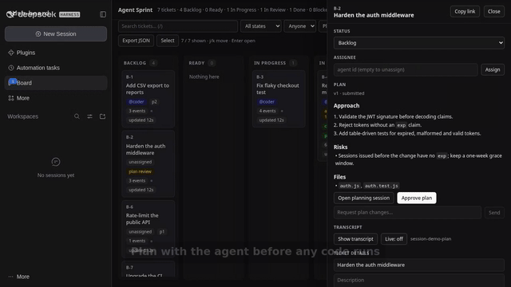

# dsh-board

**A ticket-first agent board for [DeepSeek Harness](https://github.com/deepseek-ai/deepseek-harness).**
Humans plan and approve; agents claim tickets and work in isolated Git worktrees; every run is
review-gated, budgeted and audited.

[](https://github.com/HoomerPH/dsh-board/actions/workflows/ci.yml)
[](LICENSE)


## Demo



[Watch the 41-second demo (MP4)](https://github.com/HoomerPH/dsh-board/releases/download/v0.37.0/dsh-board-demo-v2.mp4) · music + captions · [interactive tour](https://hoomerph.github.io/dsh-board/demo.html) · re-render with `node scripts/demo-video.mjs && bash scripts/build-demo-video.sh` (v1) or `node scripts/demo-cards.mjs && bash scripts/build-demo-v2.sh` (v2)

## Install from source (GitHub)

> **Not on npm.** The plain `dsh-board` name on npm belongs to an unrelated project, so distribution is
> GitHub-only for now.

Requirements: **DeepSeek Harness** with a web profile, **Node.js >= 20** (24 recommended for the
SQLite backend), **pnpm**, and **Git**.

```sh
git clone https://github.com/HoomerPH/dsh-board.git ~/dsh-board
cd ~/dsh-board
scripts/install-profile.sh          # creates/updates the `board` profile
```

Launch the board from the repository you want agents to work on:

```sh
cd /path/to/your/repo
dsh --profile board
```

Open the printed tokenized URL, click **Board** in the sidebar, and type `/board <what you want built>`
in the chat to create the first ticket. The board stores data in `$DSH_HOME/board/board.json` and creates
branches named `board/<ticket>-<run>` inside your repository.

To update: `cd ~/dsh-board && git pull` and restart the profile (the profile installs this checkout
with `link:`). To start over: stop the profile and move `$DSH_HOME/board` aside.

## Quickstart

1. **Create work from the chat.** `/board add CSV export to the reports page` creates a Backlog ticket,
   binds that chat session as its planning session, and the agent brainstorms the work with you.
2. **Approve the plan.** When the scope is clear the agent calls `board_submit_plan`; the ticket shows
   **plan review**. Approve it in the drawer (or `/board approve B-3`). Decomposition proposals become
   child tickets with dependencies.
3. **Assign and dispatch.** Give the ticket an assignee (or set `autonomy.defaultAssignee`) and it moves
   to Ready; the board starts a worker in its own Git worktree.
4. **Review the branch.** When the worker settles, the ticket is **In Review** with a diff, checks,
   artifacts and the worker transcript. **Approve** squash-merges into the base branch; **Reject**
   resumes the same worker session with your notes.
5. **Optional automation.** Reviewer sessions, auto-merge/auto-reject, PR mode, webhooks and budgets are
   opt-in and off by default. A human can always approve or reject.


## How it works

```
/board <work> ──▶ ticket ──▶ planning session (agent + human)
                              │  board_submit_plan
                              ▼
                        human approves plan
                              │
                   Ready ──▶ run controller ──▶ worker session
                              │  worktree board/<ticket>-<run>, preset "standard"
                              ▼
                        worker commits, runs checks, attaches artifacts
                              │  board_update → In Review
                              ▼
                        In Review ◀── run parked; diff + checks + transcript
                              │
              Approve ──▶ squash-merge, branch deleted, Done
              Reject  ──▶ the same session resumes with your reason
```

Each ticket has durable state; each run is a lease on a worker session and a worktree. Multiple
workers can run concurrently (`maxWorkers`), extra tickets wait in a durable priority queue, and
dependencies (`blockedBy`) hold a ticket back until its prerequisites are done.

## Features

**Planning gate** — ticket-bound planning sessions in the Harness chat; plan approval is a separate
human gate before execution. Plans can decompose work into child tickets.

**Isolated execution** — one Git worktree and branch per run, with a recorded base commit and branch.
Runs track tokens and wall-clock time; a budget overrun parks the ticket as Blocked with the measured
reason. Workers may delegate to bounded, budgeted subagent sessions.

**Review gate** — the drawer shows the change (capped unified diff + stat), per-check results (exit code,
duration, timeout/abort/signal, output tails), artifacts, run history and the worker transcript.
Approval refuses failing checks, a dirty checkout, the wrong base branch or a rewritten base, unless a
human explicitly overrides with a reason. Agents can never set the Done state.

**Scheduling and retention** — durable priority queue, dependencies, WIP limits, wall-clock and token
budgets, archive-after-days and pruning for merged checkouts. Worktree/branch garbage collection
(`/board gc`) is dry-run by default.

**Opt-in autonomy** — agents may triage to Ready, assign, and receive a default assignee; reviewer
sessions can post verdicts; auto-merge requires trusted checks **and** a reviewer approval; auto-reject
can resume the worker on `changes_requested`. Every switch defaults off.

**Notifications and integrations** — durable in-app inbox, outbound webhooks (Slack-compatible payload,
HMAC signatures, retries and delivery log), GitHub/GitLab pull-request mode with optional polling,
Agent Teams publishing/sync, and read-only transcript access.

**Storage** — JSON (default, atomic writes + rotating backups), append-only journal, or SQLite. All three
are single-writer guarded and can be exported back to `board.json`.

## Configuration

Set in the profile's `cordis.patch.yml` under `- id: board`:

| Key | Default | Meaning |
|---|---|---|
| `workspace` | launch directory | Repository the workers run in; a Git repo enables worktrees |
| `maxWorkers` | `2` | Concurrent worker sessions; extra tickets wait in the queue |
| `agentPreset` | `standard` | Agent preset mounted into each worker |
| `worktrees` | `true` | Per-run Git worktree isolation; falls back to the shared checkout with a recorded reason |
| `dataDir` | `$DSH_HOME/board` | Where the board data lives |
| `boardName` | `Agent Sprint` | Board title |
| `workflow` | six-state default | States, labels, roles and transitions (see below) |
| `backend` | `json` | `json`, `sqlite` or `journal` |
| `sqliteFile` | `<dataDir>/board.sqlite` | SQLite file for `backend: 'sqlite'` |
| `journalFile` | `<board.json>.journal` | Delta log for `backend: 'journal'` |
| `journalCompactionLines` | `200` | Lines before the journal compacts into a snapshot |
| `backupCount` | `3` | Numbered `.bak` generations |
| `gitTimeoutMs` | `120000` | Upper bound for any Git command |
| `archiveAfterDays` | `30` | Archive done tickets after this many days (`0` disables) |
| `pruneMerged` | `true` | Prune checkouts/branches left by merged runs |
| `maxSubagents` | `4` | Child sessions a worker may start; exceeding cancels the run |
| `approvalTtlHours` | `0` (off) | Max age of an approved plan before merge is refused |
| `checks` | `{}` | `{ allow: [], deny: [] }` patterns; matching commands are blocked, not executed |
| `webhooks` | `[]` | `[{ url, secret?, events?, retries? }]` — outbound notifications, max 10 |
| `sessionsDir` | `$DSH_HOME/sessions` | Where the transcript route reads session logs |
| `plannerPreset` | `standard` | Preset mounted into a ticket's planning session |
| `pullRequest` | off | `{ provider?, repository, token, base?, remote?, apiBase?, autoSync?, pollMs? }` |
| `autonomy` | all off | `{ agentsCanReady, agentsCanAssign, wipLimit, autoMerge, autoRejectOnChanges, reviewerPreset, reviewerTokenBudget, defaultAssignee }` |

### Custom workflow

```yaml
- id: board
  config:
    workflow:
      states:
        - { id: triage,   label: Triage }
        - { id: queued,   label: Queued }
        - { id: building, label: Building }
        - { id: review,   label: Review }
        - { id: shipped,  label: Shipped }
        - { id: stuck,    label: Stuck }
      initial: triage      # new tickets
      dispatch: queued     # status that starts a worker run
      active: building     # set while a run executes
      gate: review         # human review gate
      done: shipped        # approval target
      blocked: stuck       # failure/budget target
      transitions:         # optional; omit for unrestricted moves
        triage: [queued, stuck]
        queued: [building, triage, stuck]
        building: [review, stuck]
        review: [shipped, building, stuck]
        shipped: []
        stuck: [queued]
```

Statuses outside a changed workflow migrate to `initial` with a `migrated` activity event.

## Agent tools and slash commands

| Tool | Purpose |
|---|---|
| `board_list` | filter by status/assignee; run status and tokens |
| `board_get` | description, acceptance, artifacts, runs, activity |
| `board_create` | new ticket in the initial state |
| `board_claim` | claim an unassigned ticket (dependency gated) |
| `board_update` | status/title/description/assignee — **cannot set the done state** |
| `board_comment` | progress notes; delivered to a live worker |
| `board_artifact` | PR, branch, diff, report, link |
| `board_submit_plan` | submit/revise a plan from the bound planning session |
| `board_ask` | pause the run and ask the human a blocking question |
| `board_review` | independent reviewer verdict at the gate |
| `board_team_task` | publish the ticket as an Agent Teams task |
| `board_team_sync` | mirror team owner/status with the shared task |

Chat commands: `/board <work>` (create), `/board list`, `/board show <ticket>`, `/board approve <ticket>`,
`/board answer <ticket> <text>`, `/board review <ticket> <approved|changes> [notes]`,
`/board notifications`, `/board gc [apply]`, `/board export`. A bare `/board` opens the board panel.

HTTP routes (owner-peer authenticated): `/api/board/state`, `/api/board/ticket`, `/api/board/action`,
`/api/board/diff`, `/api/board/presets`, `/api/board/transcript`, plus the `/board/events` SSE channel.

## Invariants

- One worker per ticket; the UI cannot start a second run.
- No self-approval: agents cannot set the done state; only a human approves at the gate.
- A ticket in review leaves it only through **Approve** or **Reject**.
- Approval requires a clean base checkout, the run's original branch, a base history that still contains
  the run's base commit, committed changes, and (unless overridden) green checks.
- Approvals are serialized per repository; a failed squash rolls back without discarding unrelated work.
- Every mutation appends an actor/kind/text/timestamp event.
- Budget overruns cancel the run into the blocked state with the measured reason.
- One writer per board file: JSON uses mtime/size/inode + hash, SQLite a revision, the journal its size.

## Data and operations

| Task | How |
|---|---|
| Data location | `$DSH_HOME/board/` (`board.json`, or `board.sqlite` / `board.json.journal`) |
| Recover | An unreadable `board.json` is moved to `board.json.corrupt-*`; the last good `.bak` is restored and a warning appears in the panel |
| Roll back | Stop the profile, copy `board.json.bak` over `board.json` |
| Reset | Stop the profile, move `$DSH_HOME/board` aside; the next boot starts empty |
| Switch backend | Set `backend`, then export/import: the SQLite and journal backends import an existing `board.json` on first boot; `/board export` writes a JSON snapshot |
| Stop | `kill <dsh pid>` (`pgrep -af "dsh --profile board"`) |
| Logs | the launcher's stdout/stderr; plugin messages are prefixed `[board]` |
| Upgrade | pull this checkout and restart the profile |

## Troubleshooting

| Symptom | Cause / fix |
|---|---|
| Worker says it has no tools | `agentPreset` does not name a preset defined in the profile |
| `Run has no worktree` | `workspace` is not a Git repository, or the worktree package is not mounted |
| Approval fails `has uncommitted changes` | Commit or stash the base checkout, then approve again |
| Approval fails `is on "<branch>" but this run started from …` | Check out the branch the run started from |
| Approval fails `no longer contains <sha>` | The base branch was rewritten; rebase the run branch or reject and re-run |
| Approval fails `checks failed (…)` | Fix the check and reject back to the worker, or override with a reason |
| Approval fails `worker is still running` | Wait for the run to settle to the review gate |
| A Ready ticket never starts | It waits on dependencies, has no assignee, or the WIP limit is reached |
| `/board` is not offered | The profile has no `commands` service or the client bundle is stale; restart the profile |
| `no worker slot is free` when rejecting | Wait for a running ticket to finish, then reject again |
| `wall-clock budget exceeded` | Raise or clear the ticket's wall-clock minutes and retry |
| Comments stored but not delivered | Delivery needs a live worker; parked tickets replay notes in the next brief |

## Development

```sh
npm install          # dev dependency: playwright-core (browser UI tests)
npm test             # 146 offline tests: store, run controller, routes, tools, client bundle
node scripts/check.mjs
npm run e2e          # boots a throwaway profile: routes, SSE (10 checks)
npm run ui           # drives a real Chromium over the board UI (10 checks)
```

`npm run e2e` needs `dsh` on `PATH` or `DSH_BIN`; `npm run ui` needs a cached Playwright Chromium or
`PLAYWRIGHT_CHROMIUM_EXECUTABLE`. Runtime dependencies: none (only the Harness itself). See
[CONTRIBUTING.md](CONTRIBUTING.md) for conventions and [docs/ROADMAP.md](docs/ROADMAP.md) for the
detailed capability notes and design trade-offs.

## Limitations

- **Single-user and local-first.** There is no identity, RBAC or multi-user merge queue; the audit calls
  the approver "human". Team/PR-reviewer workflows would need those layers.
- **Not on npm** (name taken). Install from this repository.
- **One process per board file.** All backends refuse a second writer instead of merging concurrent
  edits; run one board profile per data directory.
- **Checks are code execution.** Commands run with the profile's shell policy; use `checks.deny`
  patterns or a restricted shell policy if ticket authors are untrusted.
- **Automation is opt-in.** Reviewer sessions, auto-merge and auto-reject stay off by default, and
  auto-merge additionally requires trusted checks and a reviewer verdict.
- **PR mode is GitHub/GitLab only** and needs a token in the profile config (`token` is never exposed to
  the client). PR completion is manual or opt-in polling; unsupported providers are out of scope.
- **Transcripts are static snapshots** of the durable session log (last 60 messages), not live streaming
  in the server; the drawer can poll (“Live” toggle).
- **UI is English-only, desktop web**, with no mobile layout.
- **Large boards**: JSON rewrites one document per save; use `backend: 'sqlite'` or `journal` beyond a few
  thousand tickets.

## License

MIT — see [LICENSE](LICENSE).
